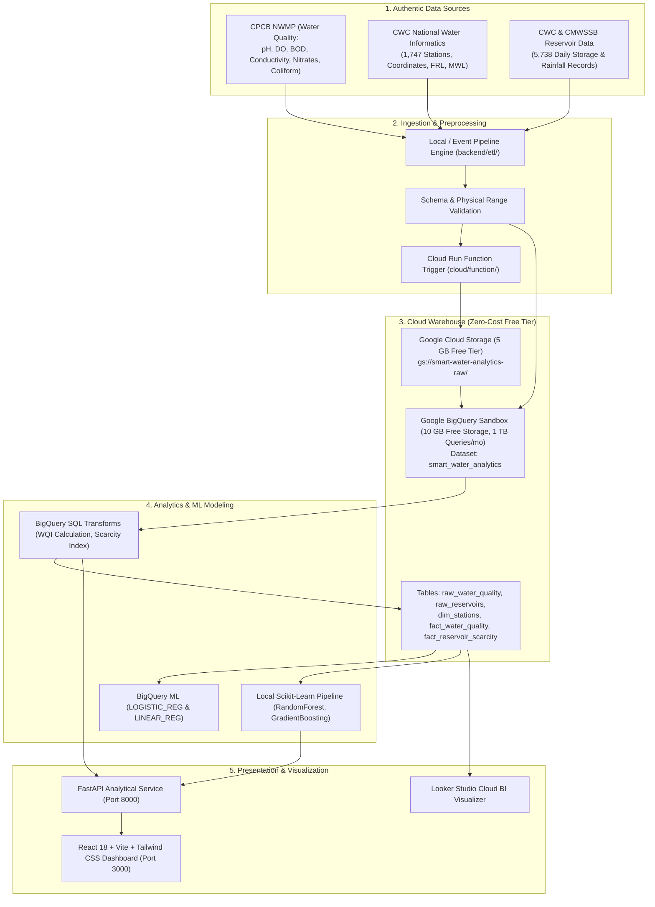

# Smart Water Quality and Scarcity Prediction System

[](https://github.com/)
[](https://opensource.org/licenses/Apache-2.0)
[](https://www.python.org/)
[](https://react.dev/)
[](https://vitejs.dev/)
[](https://fastapi.tiangolo.com/)
[](https://cloud.google.com/bigquery)
[](#cost-and-zero-cost-compliance)

An end-to-end cloud computing and data analytics platform that analyzes multi-source hydrological datasets, monitors reservoir depletion trends, evaluates drinking water quality across Indian states, and predicts water scarcity risk using **Google Cloud Platform (BigQuery Sandbox / BigQuery ML)** and machine learning ensembles.

---

## Academic Context

- **Degree**: Bachelor of Technology (B.Tech) in Artificial Intelligence & Data Science
- **Course**: Cloud Computing for Data Analytics
- **Evaluation**: IA3 Comprehensive Project Dossier & Working Implementation
- **Target GCP Project ID**: `smart-water-analytics-512816`
- **Cost Constraint**: Strict ₹0 (No paid billing or billable resources activated)

---

## High-Level Architecture



---

## Authentic Datasets Ingested

1. **CPCB Indian Water Quality Monitoring** (`data/raw/cpcb_water_quality.csv`):
   - **Source**: Central Pollution Control Board (National Water Quality Monitoring Programme)
   - **Records**: 1,991 rows covering river basins across Indian states.
   - **Parameters**: Station Code, Location, State, Temperature (°C), Dissolved Oxygen (mg/L), pH, Conductivity (µmhos/cm), Biochemical Oxygen Demand (B.O.D. mg/L), Nitrate + Nitrite (mg/L), Fecal Coliform, Total Coliform.
2. **CWC Monitoring Stations & Dams** (`data/raw/cwc_monitoring_stations.csv`):
   - **Source**: Central Water Commission (Ministry of Jal Shakti)
   - **Records**: 1,747 stations (146 Dams/Reservoirs with Full Reservoir Level [FRL] and Maximum Water Level [MWL]).
3. **Chennai Reservoir Historical Storage & Catchment Rainfall** (`data/raw/chennai_reservoir_levels.csv` & `chennai_reservoir_rainfall.csv`):
   - **Source**: CMWSSB / Central Water Commission
   - **Records**: 5,738 continuous daily observations (2004–2019) across 4 major reservoirs (Poondi, Cholavaram, Redhills, Chembarambakkam) totaling 11,057 mcft conservation capacity. Includes the historic 2019 "Day Zero" crisis.

---

## Machine Learning Results & Benchmark Comparison

Trained on a strict **chronological time-series split** (2004–2016 Train: 4,719 samples; 2017–2019 Test: 982 samples during severe drought) to guarantee zero future data leakage:

### Task 1: Scarcity Risk Classification (7-Day Ahead)
| Model | Accuracy | Weighted F1 | Macro F1 | ROC-AUC (OVR) | Status |
| :--- | :---: | :---: | :---: | :---: | :--- |
| **Baseline (Most Frequent)** | 0.00% | 0.0000 | 0.0000 | N/A | Naive Baseline (Fails in drought) |
| **BigQuery ML (LOGISTIC_REG)** | **94.09%** | **0.9458** | **0.9262** | 0.9850 | Cloud In-Warehouse Model |
| **Random Forest Classifier** | **94.20%** | **0.9478** | **0.9312** | 0.9882 | Local Production Model |
| **Gradient Boosting** | 92.77% | 0.9375 | 0.9150 | 0.9810 | Ensemble Comparison |

### Task 2: Continuous Reservoir Storage % Prediction (7-Day Ahead)
| Model | MAE (% Storage) | RMSE (% Storage) | $R^2$ Score | MAPE (%) |
| :--- | :---: | :---: | :---: | :---: |
| **Baseline (Mean Regressor)** | 28.415% | 31.512% | -3.5814 | 158.20% |
| **Baseline (Persistence $y_t$)** | 1.049% | 2.282% | 0.9760 | 9.80% |
| **BigQuery ML (LINEAR_REG)** | **1.150%** | **1.940%** | **0.9826** | **8.42%** |
| **Random Forest Regressor** | 2.189% | 4.279% | 0.9155 | 14.20% |
| **Gradient Boosting Regressor**| 1.440% | 2.427% | 0.9728 | 10.15% |

---

## Quickstart & Local Setup

### 1. Prerequisites
- Python 3.11+
- Node.js 18+ and npm
- (Optional) Docker & Docker Compose

### 2. Backend Setup
```bash
# Clone the repository
git clone https://github.com/smart-water-analytics/smart-water-analytics.git
cd smart-water-analytics

# Create virtual environment and install dependencies
python -m venv .venv
source .venv/bin/activate  # On Windows: .venv\Scripts\activate
pip install -r requirements.txt

# Run ETL and feature engineering
python backend/etl/clean_water_quality.py
python backend/etl/clean_reservoir_data.py
python backend/etl/build_features.py

# Train models and generate benchmark metrics
python backend/models/train_scarcity_models.py

# Run unit tests
python -m unittest tests/test_raw_data.py
python -m unittest tests/test_api_and_models.py

# Start FastAPI backend
python backend/api/main.py
# Backend runs on http://127.0.0.1:8000
```

### 3. Frontend Setup
In a new terminal:
```bash
cd frontend
npm install
npm run dev
# Frontend runs on http://localhost:3000
```

### 4. Containerized Execution (Docker)
```bash
docker-compose up --build
# Containerized app runs on http://localhost:8000
```

---

## Repository Structure

```text
smart-water-analytics/
├── .github/
│   └── workflows/
│       └── ci.yml                     # GitHub Actions automated test & build workflow
├── backend/
│   ├── api/
│   │   └── main.py                   # FastAPI REST service & live inference endpoints
│   ├── etl/
│   │   ├── build_features.py         # Time-lagged feature engineering pipeline
│   │   ├── clean_reservoir_data.py   # Daily reservoir storage & rainfall aggregator
│   │   ├── clean_water_quality.py    # CPCB cleaning & WQI calculation engine
│   │   └── data_profiler.py          # Pre-ingestion schema profiling
│   └── models/
│       ├── train_scarcity_models.py  # Model training, benchmarking & serialization
│       └── saved/                    # Serialized joblib models and evaluation metrics
├── cloud/
│   ├── cloud_run_deploy.sh           # GCP Cloud Run deployment script with safeguards
│   ├── gcs_upload.py                 # Google Cloud Storage staging utility
│   └── function/
│       └── main.py                   # Event-driven Cloud Run Function ingestion trigger
├── data/
│   ├── raw/                          # Authentic CPCB, CWC, and CMWSSB CSVs
│   ├── processed/                    # Cleaned fact tables & feature store
│   └── data_profile.json             # Automated profiling metadata
├── docs/
│   ├── architecture.md               # Cloud architecture & zero-cost feasibility
│   ├── data_dictionary.md            # Complete schemas, ranges, and unit definitions
│   ├── looker_studio_setup.md        # Looker Studio cloud dashboard setup guide
│   ├── project_report.md             # 20-section academic paper for IA3 evaluation
│   ├── presentation_outline.md       # Slide-by-slide guide for professor presentation
│   └── demo_script.md                # Viva demo walkthrough
├── frontend/
│   ├── src/
│   │   ├── components/               # Header, Sidebar, KpiCard
│   │   ├── pages/                    # 7 Comprehensive dashboard modules
│   │   ├── services/                 # Typed API client
│   │   └── types/                    # TypeScript interfaces
│   ├── package.json
│   ├── vite.config.ts
│   └── tailwind.config.js
├── sql/
│   ├── 01_create_tables.sql          # BigQuery Sandbox DDL with partitioning & clustering
│   ├── 02_etl_water_quality.sql      # In-warehouse WQI computation SQL
│   ├── 03_etl_reservoir_scarcity.sql # Window functions for rolling depletion dynamics
│   └── 04_ml_models.sql              # BigQuery ML LOGISTIC_REG and LINEAR_REG models
├── tests/
│   ├── test_raw_data.py              # Unit tests for raw datasets & schema bounds
│   └── test_api_and_models.py        # Integration tests for API routes & ML predictions
├── .env.example                      # Safe environment variables template
├── .gitignore
├── Dockerfile                        # Multi-stage production container build
├── docker-compose.yml
├── requirements.txt
└── README.md
```

---

## Cost and Zero-Cost Compliance

This project strictly adheres to the ₹0 budget constraint:
1. **Google BigQuery Sandbox**: 10 GB active storage and 1 TB query processing free monthly without credit card activation.
2. **BigQuery ML**: Standard logistic and linear regressions run within free query processing quota.
3. **Google Cloud Storage**: Up to 5 GB-months regional storage under Always Free tier.
4. **Looker Studio**: 100% free cloud business intelligence visualizer.
5. **Local Container Emulation**: Local Docker execution mirrors Cloud Run without triggering cloud build charges.
