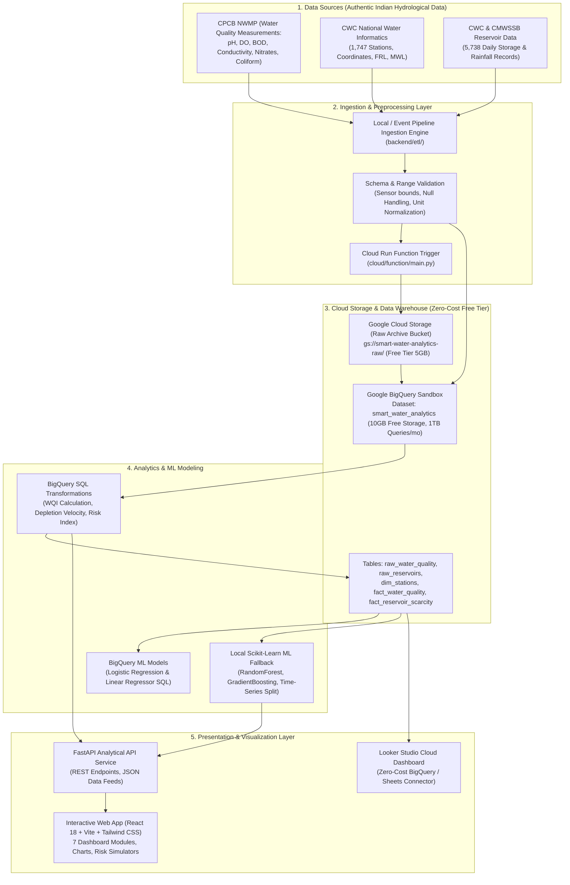

# Cloud Architecture & Zero-Cost Feasibility Specification
## Smart Water Quality and Scarcity Prediction System

**Academic Context**: B.Tech AI & Data Science — Cloud Computing for Data Analytics (IA3)  
**Target GCP Project ID**: `smart-water-analytics-512816`  
**Budget Constraint**: ₹0 (Strict Hard Constraint — No paid billing or billable resources)

---

## 1. High-Level System Architecture

The Smart Water Quality and Scarcity Prediction System is architected as an end-to-end, decoupled cloud data analytics pipeline designed to ingest, validate, transform, store, model, and visualize multi-source hydrological datasets.

---

## 2. GCP Service Selection & Zero-Cost Feasibility Analysis

| Cloud Service | Role in Architecture | Cost Tier / Free Quota Limits | Zero-Cost Feasibility Status | Fallback Strategy |
| :--- | :--- | :--- | :--- | :--- |
| **Google BigQuery** | Enterprise Data Warehouse for analytical tables & SQL transformations | **BigQuery Sandbox**: 10 GB active storage, 1 TB analytical queries per month free. | **100% Free** (No credit card or billing account activation required). | SQLite / Local DuckDB in-memory analytical database |
| **BigQuery ML** | In-database machine learning training & inference via SQL | Covered under BigQuery Sandbox query quota for standard models (Linear, Logistic, K-Means). | **100% Free** within the 10 GB storage and 1 TB monthly query processing quota. | Scikit-learn ML pipeline with identical feature engineering & metric benchmarks |
| **Google Cloud Storage (GCS)** | Object storage for raw dataset CSV/Parquet uploads and schema artifacts | GCP Free Tier grants 5 GB-months of Regional Storage in `us-east1`, `us-west1`, or `us-central1`. | Free tier available; in projects without billing, Sandbox prevents bucket provisioning without card. | Local structured storage (`data/raw/` and `data/processed/`) with automated GCS staging scripts |
| **Cloud Run / Functions** | Event-driven serverless ETL and HTTP API serving | GCP Always Free allows 2 million invocations, 360,000 GB-seconds memory, 180,000 vCPU-seconds per month. | Requires active billing account to build container images on GCP Artifact Registry. | Docker containerization (`docker-compose.yml`) running FastAPI + Vite locally or on free hosting |
| **Looker Studio** | Cloud business intelligence and interactive reporting dashboard | Looker Studio is completely free for individual and institutional Google accounts. | **100% Free** when connecting directly to BigQuery Sandbox or uploaded CSV extracts. | Custom React 18 dashboard with interactive Recharts, KPI widgets, and map visualizers |

---

## 3. Security, Privacy & Least-Privilege IAM Plan

1. **Zero Secret Leakage**:
   - No service account keys (`credentials.json`), API keys, or project credentials will ever be committed to Git.
   - Dedicated `.gitignore` configured to exclude `.env`, `*.json` keys, virtual environments (`.venv`), and raw binary caches.
   - Environment variables defined through `.env.example` with clear placeholders (`GCP_PROJECT_ID=smart-water-analytics-512816`).
2. **Least Privilege IAM**:
   - `roles/bigquery.dataEditor`: Required only for ETL service accounts writing to the target dataset.
   - `roles/bigquery.user`: Required for analytical query execution and ML model training.
   - `roles/storage.objectViewer`: Read-only access to raw data staging buckets.
3. **Data Integrity & SQL Injection Safety**:
   - All SQL transformations in Python and API routes use parameterized statements or SQLAlchemy abstractions.
   - Sensor bounds validation prevents malicious or malformed input from contaminating downstream data models.
